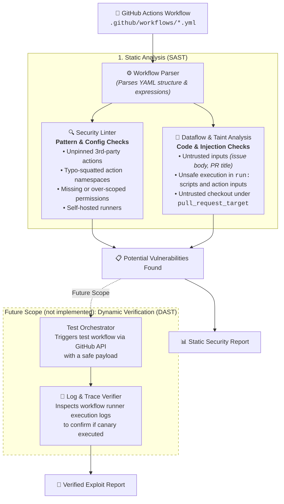

# ActionLens 👾

**ActionLens** is a static analysis tool (SAST) designed to audit GitHub Actions CI/CD workflows for security vulnerabilities, unsafe data flows, and configuration weaknesses.

---

## Objectives & Scope

Modern CI/CD pipelines hold privileged access to source code, cloud credentials, production environments, and release artifacts. ActionLens targets security risks in workflow definitions through static analysis. A dynamic layer is described below only as possible future work:

### 1. Static Analysis (SAST)
- **Semantic Code & Taint Analysis:**
  - Evaluates untrusted data flows from event contexts (e.g., issue titles, PR bodies, comments, branch names) to dangerous execution sinks (e.g., inline shell scripts via `${{ github.event... }}` or `actions/github-script` inputs), including flows through step `env:` variables and step outputs.
  - Detects untrusted pull request code checked out under the privileged `pull_request_target` trigger.
- **Security Linting:**
  - AST-based pattern matching for supply-chain risks: unpinned third-party actions using mutable tags like `@v1` or `@main` instead of immutable commit SHAs, and typo-squatted or impersonated action namespaces.
  - Privilege and runner misconfiguration: missing or over-scoped `permissions:` blocks and self-hosted runners.

### 2. DAST Exploit Harness (Future Scope, Not Implemented)
> Not part of the current project.

- **API Orchestrator & Log Verifier:**
  - Would trigger targeted runs of flagged workflows in controlled environments (test repositories / ephemeral runners).
  - Would check whether a candidate vulnerability is exploitable by inspecting execution traces and runner logs.

---

## 🗿 Architecture Overview



For detailed specifications, see:
- [Architecture Guide](docs/architecture.md)
- [Vulnerability Matrix](docs/vulnerability-matrix.md)
- [Development & Contribution Guide](docs/development.md)
---

## Usage

### 1. Prerequisites
- **Go** (version per `parser/go.mod`, currently 1.27.1) for building the AST parser
- **Python 3.10+** (for the security analysis engine)

### 2. Build the Go Parser
The Python engine invokes a standalone Go binary to parse workflow YAML and expression ASTs:
```bash
cd parser
go build -o actionlens-parser .
cd ..
```

**Note:** go parser can also be used independently for generating AST: 
```bash
./parser/actionlens-parser <filename>
```

### 3. Set Up Python Environment
Create and activate a virtual environment, then install dependencies and the package:
```bash
python3.10 -m venv .venv # or python -m ... if using Python 3.10 or newer
source .venv/bin/activate
pip install -r requirements.txt
pip install -e .
```

### 4. Run the Security Scanner
With the virtual environment activated:

```bash
# Scan a workflow file with human-readable table output
actionlens testdata/vulnerable/excessive_permissions.yml

# Or run via Python module syntax
python3 -m actionlens testdata/vulnerable/excessive_permissions.yml

# JSON Format
actionlens testdata/vulnerable/excessive_permissions.yml --format json
```

### 5. Run the Test Suite
```bash
pytest -v tests/
```

---

## 📁 Repository Layout

```text
actionlens/
├── README.md                  # Project overview and roadmap
├── docs/                      # Architectural specifications & documentation
│   ├── architecture.md        # Technical architecture
│   ├── vulnerability-matrix.md# Catalog of targeted vulnerabilities
│   ├── development.md         # Development guideline and LLD
│   └── rules/                 # Detection rule specifications
├── parser/                    # Go-based AST parser (actionlint wrapper)
│   ├── main.go                # Emits normalized AST JSON
│   ├── parser.go              # Workflow and expression parser
│   ├── expression.go          # Expression context & action reference parsing
│   ├── models.go              # Normalized AST Go structs
│   ├── parser_test.go         # Go parser tests
│   ├── go.mod
│   └── go.sum
├── actionlens/                # Core Python package (SAST, Taint, CLI)
│   ├── cli.py                 # CLI entry point (scan and format)
│   ├── parser.py              # Invokes parser binary and loads AST JSON
│   ├── models.py              # Pydantic schemas (AST, Rules, Findings)
│   ├── sast/                  # SAST orchestrator, lint rules & taint engine
│   ├── utils/                 # Helper utilities
│   └── reporting/             # Console and JSON formatters
├── testdata/                  # Test workflows (benign & vulnerable samples)
│   ├── vulnerable/            # Vulnerable workflow samples for regression tests
│   └── secure/                # Remediated & safe workflow samples
├── tests/                     # Pytest test suite
├── pyproject.toml             # Python package configuration & CLI entrypoint
└── requirements.txt           # Python dependencies
```


**Note:** Detailed breakdown of vulnerabilities can be found in [`docs/vulnerability-matrix.md`](docs/vulnerability-matrix.md).

---

## 📜 License

[MIT](LICENSE)
