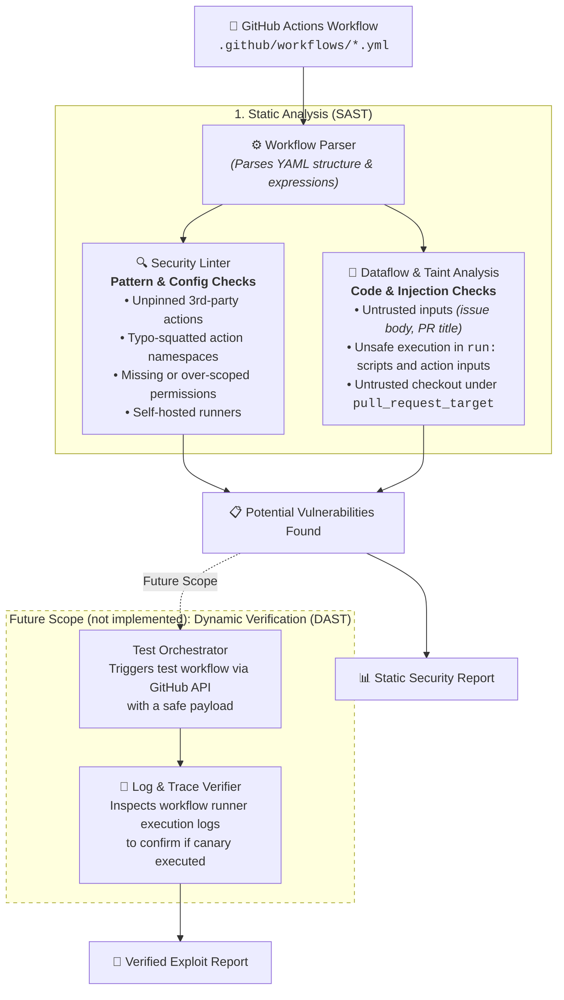

# ActionLens Architecture Specification

This document details the architectural design of **ActionLens**, a static analysis (SAST) tool. Dynamic verification (DAST) was part of the original plan but has been moved to future scope. It is described in Section 3 only as a possible extension and is not implemented.

---

## 1. High-Level System Architecture



---

## 2. SAST Subsystem

The Go parser (`parser/`) wraps actionlint and turns each workflow into a normalized AST in JSON. `actionlens/parser.py` runs the parser binary and validates its output into the `WorkflowAST` pydantic model. The `SASTOrchestrator` (`actionlens/sast/orchestrator.py`) then runs every registered rule on the AST and sorts the findings by file and line. Rules are registered by hand in the orchestrator; there is no automatic discovery.

The rules fall into two complementary layers that both operate on the normalized AST:

### 2.1 Security Linting Layer (`actionlens/sast/rules/lint/`)
The linter performs AST pattern matching on workflow structure and metadata without constructing dataflow graphs.

- **Input:** `WorkflowAST` (parsed from the Go parser's JSON output).
- **Scope:**
  - Unpinned third-party actions: `uses:` not pinned to a 40-character commit SHA (`AL-LINT-001`).
  - Action namespaces: typo-squatted owners and official repository names under a foreign owner (`AL-LINT-002`).
  - Permissions: a missing top-level `permissions:` block, or `write-all` at the workflow or job level (`AL-LINT-003`).
  - Runner configuration: `self-hosted` runner labels, rated HIGH when untrusted triggers such as `pull_request` or `issue_comment` can start the workflow (`AL-LINT-004`).
- **Rule Interface (Python):**
  ```python
  from actionlens.models import Rule, Finding, WorkflowAST
  from actionlens.sast.rules.catalog import RULE_CATALOG

  class LintRule(Rule):
      metadata = RULE_CATALOG["AL-LINT-XXX"]

      def check(self, ast: WorkflowAST) -> list[Finding]:
          ...
  ```
- **Rule Metadata:** All rule metadata (ID, name, default severity, category, description, CWE, OWASP CI/CD category, remediation) lives in a single catalog, [`actionlens/sast/rules/catalog.py`](../actionlens/sast/rules/catalog.py). Rule classes contain only detection logic and reference their catalog entry via `metadata`; the `Rule` base class exposes `rule_id`, `severity`, `remediation`, etc. as read-only properties.

---

### 2.2 Taint Analysis Layer (`actionlens/sast/rules/taint_analysis/`)
The taint layer follows untrusted values from GitHub event contexts to the places where they are executed. There is no shared taint engine: each data-flow rule (`AL-CODE-001`, `AL-CODE-002`) builds its own graph with its own `build_taint_graph(ast)`, on top of the shared `TaintGraph` class in `taint_graph.py`.

#### Concepts:
1. **Sources (Untrusted Input):**
   Context expressions that external users can control. `AL-CODE-001` uses the `UNTRUSTED_CONTEXTS` set in `script_injection.py`.
   - Examples: `github.event.issue.body`, `github.event.pull_request.title`, `github.event.comment.body`, `github.head_ref`, `github.event.head_commit.message`.
   - `AL-CODE-002` uses a smaller set of pull request head refs and SHAs.
2. **Propagators:**
   Values that carry taint from one place to another:
   - Step-level environment variables (`env:` mappings).
   - Step outputs written to `$GITHUB_OUTPUT` and read back as `steps.<id>.outputs.<name>`.
   - For `AL-CODE-002`, a checkout of an untrusted ref, which taints every later step in the same job.
3. **Sanitizers:**
   Patterns that stop taint before it reaches a sink. `AL-CODE-001` treats an untrusted value that is bound to `env:` and read in the script as `$VAR` as safe, because the shell expands the variable at runtime instead of pasting the value into the script text:
     ```yaml
     # Safe: Shell variable evaluated at runtime
     env:
       TITLE: ${{ github.event.issue.title }}
     run: echo "$TITLE"
     ```
4. **Sinks (Execution Points):**
   Locations where strings are executed as code, listed in the `SINKS` set in `script_injection.py`:
   - `run:` scripts.
   - Action inputs: `with.script` (`actions/github-script`), `with.inlinescript`, `with.args`, `with.entrypoint`, `with.command`, `with.cmd`, `with.ref`, and `with.repository`.

#### Graph Representation:
`TaintGraph` is a subclass of NetworkX's `DiGraph`:
- **Nodes:** Typed as `SOURCE`, `PROPAGATOR`, `SANITIZER`, or `SINK`, and deduplicated by type and value.
- **Edges:** Point from the sink towards the source, so the path search runs `nx.all_simple_paths(graph, sink, source)`.
- **Vulnerability Condition:**
  - `AL-CODE-001` reports a path from a sink to an untrusted source, unless the node right after the sink is a sanitizer.
  - `AL-CODE-002` only builds a graph when the workflow is triggered by `pull_request_target`. It reports when `actions/checkout` checks out an untrusted pull request ref and a later step in the same job runs a sink, with no sanitizer on the path.
- **Line Numbers:** Findings point to the start line of the step that contains the sink, not the exact line inside the script.
- **Visualization:** Passing `visualize_path="out.html"` to a taint rule writes an interactive pyvis graph (`visualization.py`).

#### Current Limitations:
- Workflow-level and job-level `env:`, job outputs, `needs.*`, reusable workflows, and matrix values are not followed.
- Only the first untrusted context in an expression is reported.
- `github.event.inputs.*` and wildcard sources are not modeled.

---

## 3. DAST Verification Subsystem (Future Scope, Not Implemented)

> [!NOTE]
> Dynamic verification (DAST) was part of the original plan but has been moved entirely to future scope. This section only describes a possible extension.

A future DAST layer would be an optional validation harness that verifies candidate findings by testing them in an authorized sandbox environment.

### 3.1 Planned Verification Process
1. **Candidate Ingestion:**
   Takes candidate findings from SAST (e.g., suspected expression injection in an `issue_comment` trigger).
2. **Safe Canary Generation:**
   Generates a non-destructive probe string with a unique token (e.g., `CANARY_VERIFIED_<UUID>`).
3. **Orchestrated Trigger:**
   Uses GitHub REST APIs via `httpx` / `PyGithub` to trigger the candidate workflow with the canary token.
4. **Log & Trace Verification:**
   Polls workflow run status via GitHub Actions API, downloads execution logs, and checks for the canary token in stdout/stderr.
5. **Report Generation:**
   If the canary token executed in the sink context, the finding is confirmed as verified.

> [!CAUTION]
> DAST verification MUST only run against authorized, isolated sandbox repositories.

---

## 4. Reporting (`actionlens/reporting/formatter.py`)

ActionLens supports two output formats, chosen with `--format`:
- **Terminal (`cli`, default):** A table rendered with `rich`, with columns for rule ID, severity, OWASP CI/CD category, message, and remediation. If `rich` is not installed, a plain-text report is printed instead, which also shows the file and line of each finding.
- **JSON (`json`):** A list of findings, each with `rule_id`, `severity`, `file_path`, `line`, `message`, `remediation`, `cwe`, and `owasp_cicd`. When there are no findings, a single `message` object is printed instead.

The CLI exits with code `1` if any finding is HIGH or CRITICAL, and `0` otherwise.

SARIF output is not implemented and is left as future scope.
