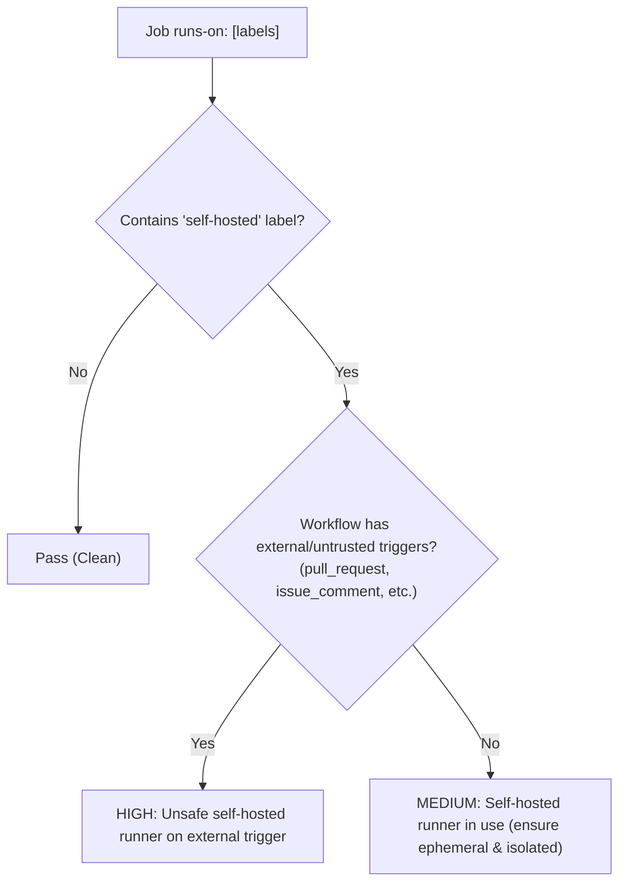

# AL-LINT-004: Unsafe Self-Hosted Runner Usage

---
## 1. Overview & Threat Model

GitHub Actions supports self-hosted runners, allowing organizations to execute workflows on dedicated on-premise servers or cloud VMs. However, GitHub strongly advises against using self-hosted runners on public repositories or workflows triggered by pull requests.

### Threat Model
1. **Public Repository Compromise:** On public repositories, any outside user can submit a pull request that triggers workflows. If the workflow executes on a persistent self-hosted runner, the attacker can execute arbitrary commands on the runner host.
2. **Persistence & Lateral Movement:** Unlike ephemeral GitHub-hosted runners that are destroyed after each job, persistent self-hosted runners retain files, credentials, and Docker daemon access across runs. An attacker can plant backdoors, steal secrets left in the filesystem, or pivot to other systems on the internal network.
3. **Container Escapes:** Even when workflows run inside containers, container breakout vulnerabilities can lead to full host compromise.

---

## 2. Detection Flow

---
### Detection Criteria
- **Severity HIGH:** Job specifies a `self-hosted` runner label and the workflow is triggered by external/untrusted events (`pull_request`, `pull_request_target`, `issue_comment`, `issues`, `discussion`, `workflow_run`).
- **Severity MEDIUM:** Job specifies a `self-hosted` runner label on internal triggers (`push`, `workflow_dispatch`, etc.), serving as a security hygiene warning.
