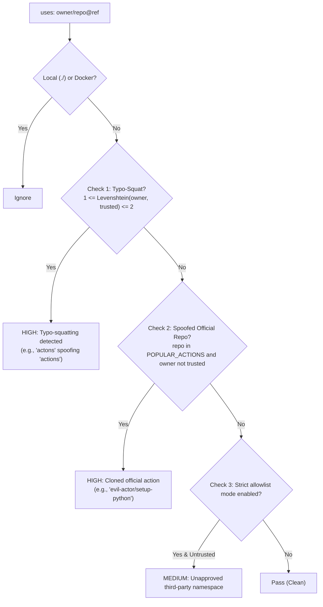

# AL-LINT-002: Compromised / Untrusted Action Namespace

---
## 1. Overview & Threat Model

In GitHub Actions workflows, third-party actions execute with access to the runner environment, including secrets, repository source code, and potentially privileged `GITHUB_TOKEN` credentials.

Attackers exploit this via **CI/CD supply-chain impersonation**:
1. **Typo-Squatting:** Registering organization or user names with minor spelling variations of popular, verified namespaces (e.g., `actons/checkout` or `act1ons/checkout` mimicking `actions/checkout`). Developers can easily miss single-character typos during review.
2. **Cloned Official Actions:** Replicating known official action repository names (e.g., `setup-python`, `checkout`, `cache`) under an untrusted personal or organization account (e.g., `evil-actor/setup-python`), often bundling backdoors or credential exfiltration hooks.
3. **Unverified Third-Party Namespaces:** Incorporating community actions from arbitrary, unapproved publishers without organizational vetting.

---

## 2. Detection Flow

The rule analyzes each `uses:` clause in a workflow step, filtering out local relative paths (`./`) and Docker actions (`docker://`), then performs three sequential checks:

### Detection Criteria
- **Check 1 (Typo-Squatting):** Computes Levenshtein distance between `owner` and configured trusted namespaces (default: `actions`, `github`). If $1 \le \text{distance} \le 2$, a `HIGH` severity finding is emitted.
- **Check 2 (Cloned Official Action):** Checks if the action repository belongs to standard official actions (`checkout`, `setup-node`, `setup-python`, `cache`, etc.) while `owner` is outside the trusted namespaces. A `HIGH` severity finding is emitted.
- **Check 3 (Strict Allowlist Mode):** If strict enforcement is enabled (`flag_all_untrusted=True`), any action whose `owner` is not in the trusted allowlist produces a `MEDIUM` severity finding.